## how are social bonds forged?

1. **biochemical bonds**: what are the potential neurochemical mechanisms involved in social bonding?
2. **social reward**: what is it about an interaction that makes it feel 'rewarding'? what do we mean when we say that we 'clicked' with someone? 
3. **synchrony**: do our brains 'get in sync' when we interact or when we experience things together, and could this be a candidate mechanism?
4. **coexperiences**: why does the same stimulus impact us differently when we experience it together vs alone? 
5. **role of communication medium**: why does face-to-face contact seem critically important in establishing lasting and deep social bonds? 

# storytime {background-color="white"}

The day I saw Pulp Fiction (1994) in a movie theatre...

:::: {.columns}

::: {.column width="50%"}

{height="400px"}

:::

::: {.column width="50%" .fragment}
...with my mother 😱
:::

::::

# overview

- theories about why co-experiences affect us
  - altercentric cognition
  - theory of collective mind
- sharing attention and its effects on bonding
- sharing emotion and its effects on bonding

## altercentric cognition {background-color="white"}

@Kampis_Southgate_2020

![The Scope of Altercentric Influence.
Orange and purple fields indicate the perceptual range of self and other. Orange boxes indicate some of the different ways in which the other can interact with, relate to, or process, the target of their attention (indicated by the green tree). Each of these can, in turn, exert an influence on our own information processing (effects on the self, listed in the purple box), but this does not imply that the observer must represent the other as experiencing a particular state to be influenced by that state. For example, an infant may be influenced by the others’ belief, but the infant may represent the others’ relationship with the object in a non-mentalistic way. The “∝” (proportional to) symbol indicates that the representation formed by the self (gray tree) will change in relation to the processes indicated on its right side, which, in turn, are modulated by the altercentric influence. Red boxes depict factors that may modulate the extent of altercentric influence, including how we perceive the others’ task or their relationship to us.](img/kampis_southgate.jpg){fig-align="center"}

## theory of collective mind {background-color="white"}

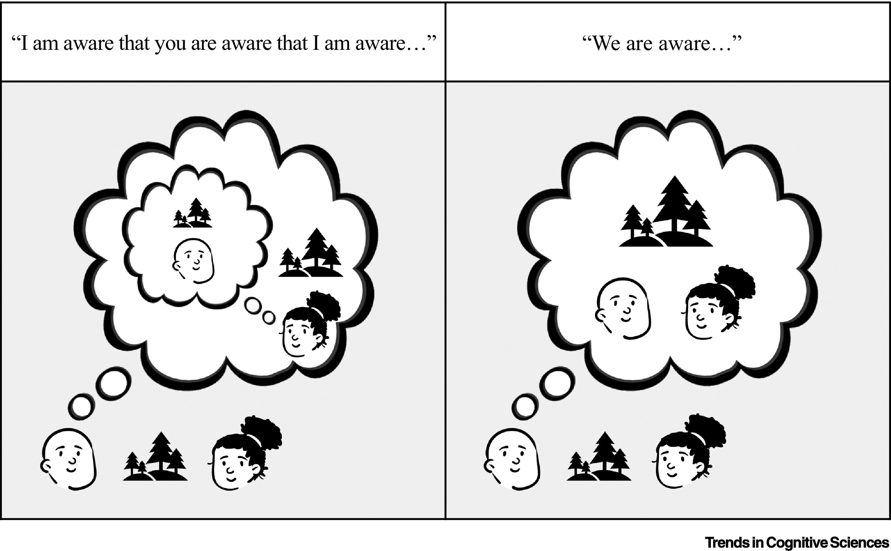{fig-align="center"}

## {background-image="img/collective-table.png" background-color="white" background-size="contain" .smaller}

## social facilitation (and inhibition) {background-color="white"}

:::: {.columns}

::: {.column width="40%"}

:::

::: {.column width="60%"}

- social effects on performance:

  - **audience** effects: while being observed
  - **co-action** effects: acting together

- performance improves in presence of an audience [@Triplett_1897]
- however this *social faciliation* is only for simple tasks; complex tasks exhibit *social inhibition*
- social presence increases arousal, and the performance function obeys Yerkes-Dodson law [@Zajonc_1965]

:::

::::

## shared motor representations: simon task {background-color="white" .smaller}

:::: {.columns}

::: {.column width="60%"}

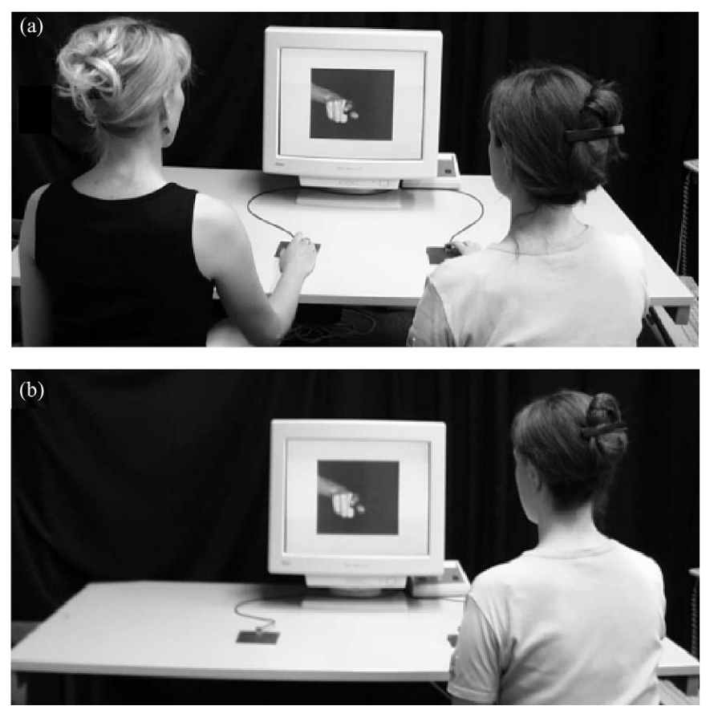{height="430px"}

Participants completed a variant of the Simon task [@Craft_Simon_1970; @Simon_1990]. On each trial they saw a hand in the centre of the screen and responded to the color of a ring on the hand (e.g., red or green)

:::

::: {.column width="40%"}

@Sebanz_Knoblich_Prinz_2003

::: {.list-table header-rows=0}

- - red ring
  - green ring

- - left button
  - right button

:::

::: {.list-table}

- - compatible
  - neutral
  - incompatible

- - 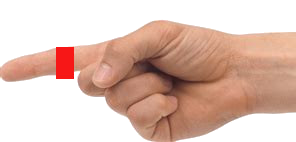
  - 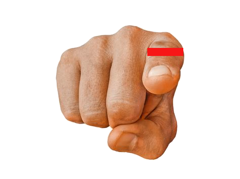
  - 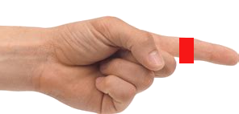

- - 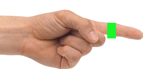
  - 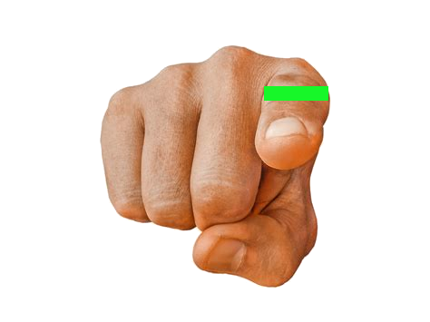
  - 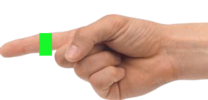

:::

- **two-choice**: single person responds to both colors
- **joint go-nogo**: each person responds to a different color
- **individual go-nogo** : single person responds to a single color

:::

::::

## {background-color="white" .smaller}

:::: {.columns}

::: {.column width="60%"}

![@Sebanz_Knoblich_Prinz_2003; Mean RTs on compatible, neutral, and incompatible trials in the two-choice condition (a), the joint go-nogo condition (b), and the individual go-nogo condition (c). Mean RTs in the two-choice condition were 446 ms (SD ¼ 40 ms), 452 ms (SD ¼ 40 ms), and 455 ms (SD ¼ 43 ms), in the joint go-nogo condition 325 ms (SD ¼ 32 ms), 331 ms (SD ¼ 32 ms), and 336 ms (SD ¼ 32 ms), and in the individual go-nogo condition 323 ms (SD ¼ 32 ms), 319 ms (SD ¼ 30 ms), and 326 ms (SD ¼ 28 ms).](img/sebanz_et-al_2003_e1_results.png)

:::

::: {.column width="40%"}

::: {.list-table header-rows=0}

- - red ring
  - green ring

- - left button
  - right button

:::

::: {.list-table}

- - compatible
  - neutral
  - incompatible

- - 
  - 
  - 

- - 
  - 
  - 

:::

:::

::::

## the N400 ERP component {background-color="white"}

:::: {.columns}

::: {.column width="35%"}

Discovered by @Kutas_Hillyard_1980

Rapid Serial Visual Presentation (RSVP)

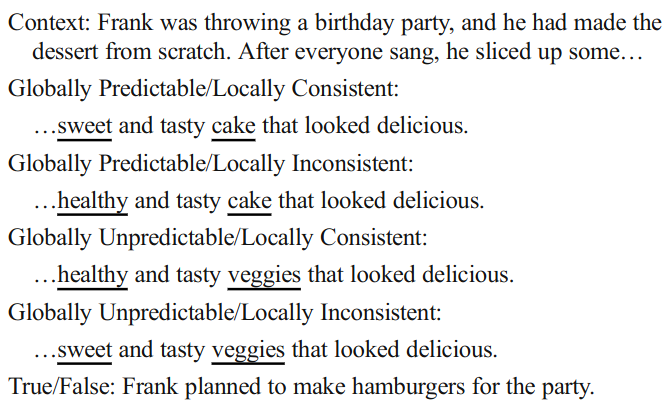

:::

::: {.column width="65%"}

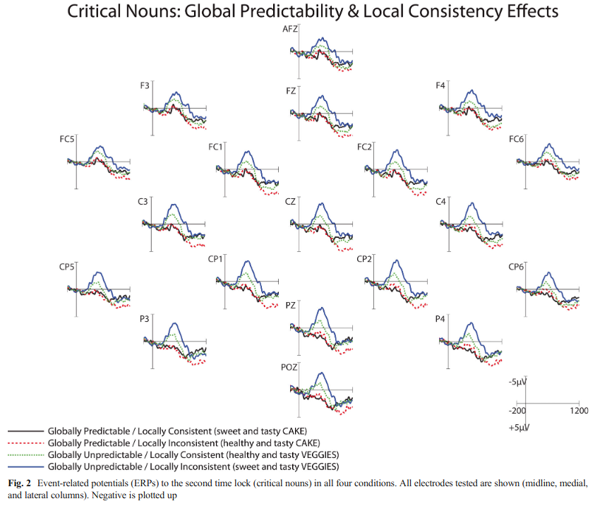

:::

::::

## is there a social N400?

@Rueschemeyer_Gardner_Stoner_2015

::: {.callout-note}

### example passage

::: {.list-table header-rows=0}

- - plausible (control)
  - The fishmonger prepared the fish. The fish had GILLS

- - implausible context
  - The boy woke up at dawn. The boy had GILLS
  
- - context
  - In the boy's dream, he could breathe underwater. The boy had GILLS

:::

:::

Participants heard the context sentence privately through headphones, and was explicitly asked to take the perspective of another participant (confederate) who could not hear the context sentence.

There were 42 different passages in each of the 3 conditions. Each participant heard one version of each.

## yes, there seems to be a social N400 {background-color="white" .smaller}

:::: {.columns}

::: {.column width="70%"}

![@Rueschemeyer_Gardner_Stoner_2015; Event-related potentials (ERPs). The left panel shows the ERPs elicited by target words (onset of critical word = 0 ms) in the Joint Group plotted for the midline electrodes (Fz, Cz, Pz). The right panel shows the ERPs elicited by target words in the Alone Group. PLAUS = plausible sentence stimuli (PLAUS); IMPLAUS = semantically implausible sentences; CONTEXT = sentences that were plausible only with the disambiguating context. A significant difference in amplitude (an N400-effect) is seen for the comparison between PLAUS and IMPLAUS sentences in both groups (a classic N400-effect) and between PLAUS and CONTEXT only in the Joint Group (the novel Social N400-effect). Crucially, there is no significant difference between PLAUS and CONTEXT in the N400 time window in the Alone Group](img/social-N400.png){fig-align="center" height="450px"}

:::

::: {.column width="30%"}

- $N=42$ participants

- 3 × 2 ANOVA with the within subject factor Condition (PLAUS, IMPLAUS, CONTEXT) and the between subjects factor Group (Joint, Alone)
  - significant main effect of Condition, F(2,60) = 7.40; p = .001
  - significant Condition × Group interaction, F(2,60) = 3.44; p = .039
  
However, participants were *explicitly instructed* to take the confederate's perspective

Also... stimuli treated as fixed effects 😐

:::

::::

## follow-up study

@Jouravlev_et-al_2019 attempted to elict the social N400 under four conditions:

1. explicit perspective-taking instructions
2. decide whether the target sentence makes sense (for self and other)
3. passive reading only
4. under cognitive load

social N400 obtained under (1) and (2) but not under (3) and (4)

concern: target word always in a predictable place (end of the sentence), could this elicit strategic processing?

and again... stimuli treated as fixed effects 😐

# 'altercentric' or 'egocentric'? {background-color="white"}

Are there limits to taking another's perspective into account, and if so, what are they?

## privileged knowledge / director task

:::: {.columns}

::: {.column width="15%"}

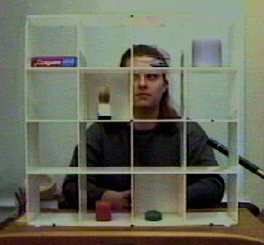

:::

::: {.column width="85%"}

> "Pick up the small candle and..."

:::

::::

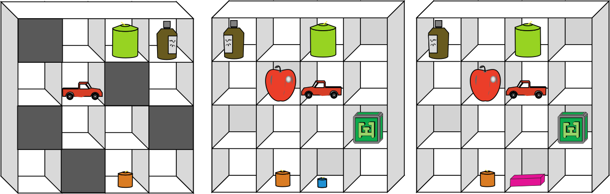{height="250px"}

When a 'competitor' was present, people made errors ~20% of the time, experienced severe delays identifying the intended referent

## identity vs existence {background-color="white"}

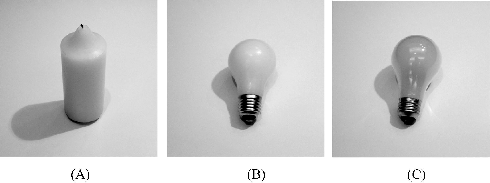{fig-align="center"}

## {background-image="img/mozuraitis_design.jpg" background-color="white" background-size="contain"}

## results: identity vs existence {background-color="white"}

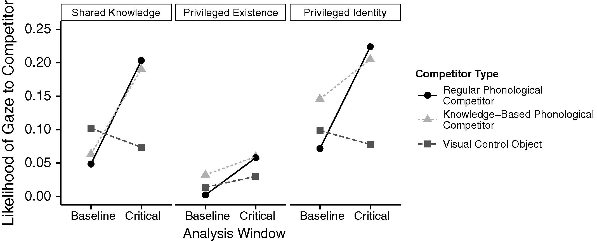

## joint attention, shared goals, social bonding {background-color="white" .smaller}

@Wolf_Launay_Dunbar_2016: Do **joint attention** and **shared goals** modulate social closeness?

::: {.list-table}

- - joint attention
  - disjoint attention

- - {height="250px"}
  - 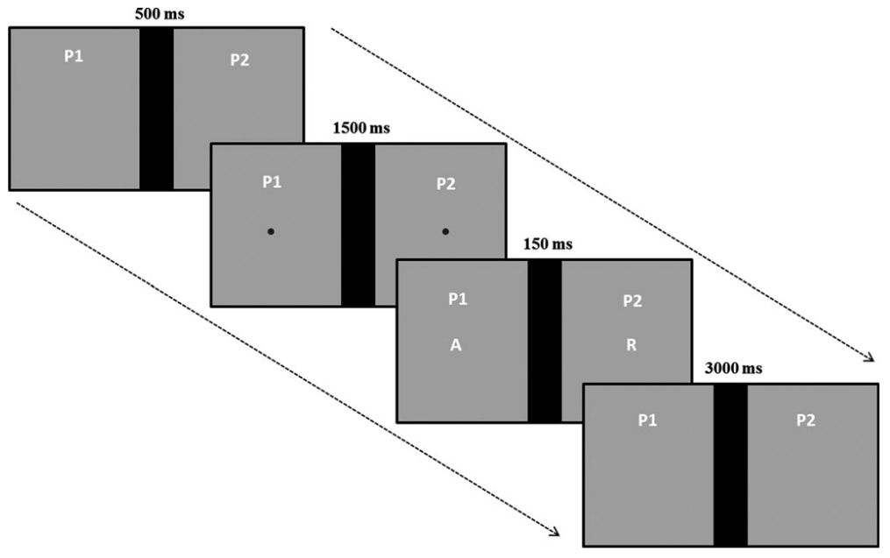{height="250px"}
  
:::

press yellow button for a consonant (K, R) and blue button for a vowel (A, O)

different partners for each attention condition (within-participant)

- shared vs individual goal (between)
  - individual: "aim for a max RT of 300 ms with 95% accuracy"
  - shared: "aim for a team max RT of 300 ms with 95% accuracy" (averaged scores)
  
- fill out a 'social bonding' questionnaire

## results {background-color="white"}

64 participants (20 male; 32 same-sex dyads)

Mean bonding score for **joint** condition ($M=49.5$, $SD=12.4$) about **3.3 points higher** than for the **disjoint** condition ($M=46.2$, $SD=11$).

No main effect of shared vs. individual goal; no evidence for any interaction.

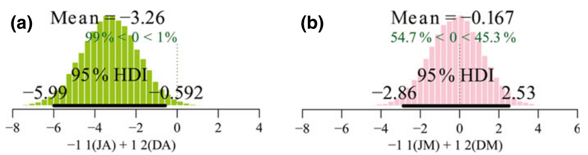{fig-align="center"}

::: {.notes}

- 24 practice trials at the beginning of each block, followed by 4 blocks of 24 trials each (96)

:::

## ingroup/outgroup and collective mind? {background-color="white" .smaller}

@He_Lever_Humphreys_2011: Are people more likely to form a collective mind with perceived ingroup members than with perceived outgroup members?

:::: {.columns}

::: {.column width="70%"}

![A peripheral cue (‘X’) at the beginning of each trial indicated which participant was to perform the memory and search tasks. The cued participant kept the preview image in memory if it was from his/her category or did nothing for the preview if the cue was from another category. There then followed a search display, and the task was to make a speeded response to the presence of circles. After the search display, there was a memory test where the participant had to judge which of two images was presented as the preview, but only when the previewed image was to be memorised](img/he_et-al_method.png){height="400px"}

:::

::: {.column width="30%"}

Visual search task performed in dyads

3 categories of images for the memory task: *fruit*, *animals*, *musical instruments*

Each dyad member got assigned a different category. Key question is what happens when the image is from your partner's category.

Task: speeded response to presence of circles

cues could be **valid** or **invalid**

- British strangers (outgroup)
- British friends (ingroup)
- Chinese migrants to UK (ingroup)

:::

::::

## results {background-color="white" .smaller}

::: {.list-table}

- - British/White friends (ingroup)
  - British/White strangers (outgroup)
  - Chinese migrants to UK (ingroup)
  
- - 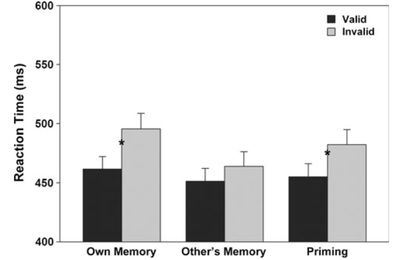
  - 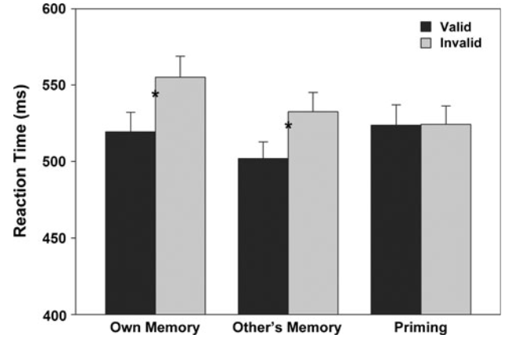
  - 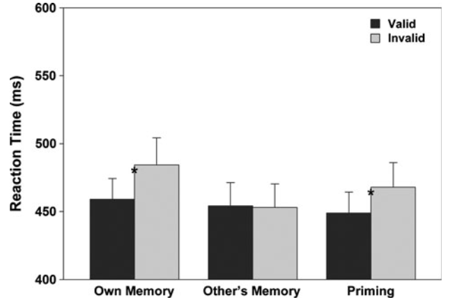

:::

For RT in the Other's memory condition, effect of Validity only appeared for the outgroup condition. This runs counter to the idea that you are more likely to form a collective representation with ingroup members!

He et al. suggest an explanation in terms of self-presentation + cognitive control

::: {.notes}

in the 'stranger' condition, self-presentation concerns may have invoked self-presentation concerns, and that these processes may have competed with cognitive control needed to suppress the other's perspective

:::

::: {.aside}

The paper uses the term 'Caucasian' to refer to the British White participants in this paper. This term is [from a discredited and archaic theory of biological race](https://en.wikipedia.org/wiki/Caucasian_race); I used British/White instead

:::

## sharing an experience in common ground {background-color="white" .smaller}

@Wolf_Tomasello_2020

:::: {.columns}

::: {.column width="80%"}

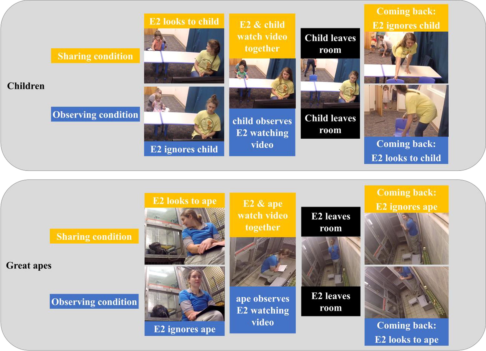{fig-align="center"}

:::

::: {.column width="20%"}

- 64 children 2.5-3yo
- 19 great apes (tested within participants), 14 chimps and 5 bonobos

- DV: rate of approach to experimenter after returning to room

:::

::::

## {background-color="white"}

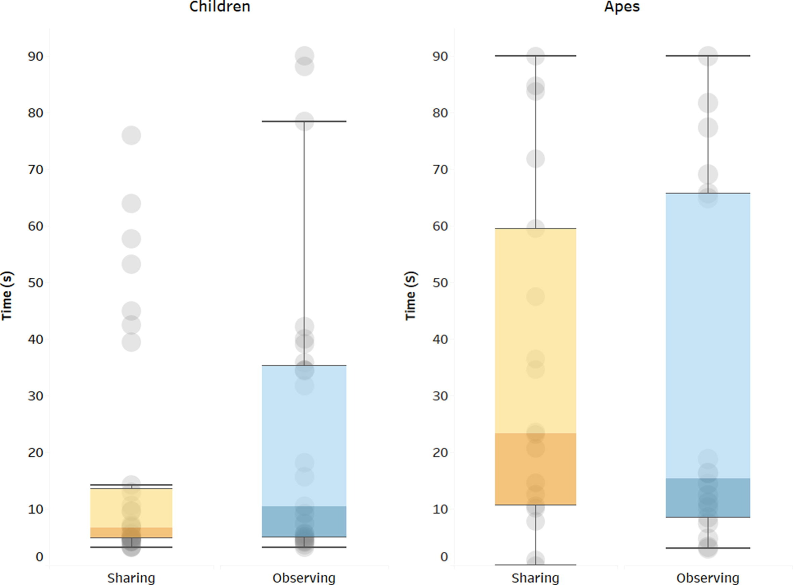{fig-align="center"}

# interim summary

- people form collective ("we") representations spontaneously that encode basic information about shared goals as well as about others' attentional and volitional states
  - another's motor representations can interfere with one's own
  - people spontaneously represent others' perspectives and use them during comprehension
    - but there are limits to this ability
- sharing attention leads to feelings of closeness and trust
  - especially if the sharing is in "common ground"

# experiencing emotions together and social bonding

# social buffering

Review by @Kikusui_Winslow_Mori_2006

*The presence of a conspecific diminishes stress responses to aversive stimuli.*

Demonstrated in rats, guinea pigs, non-human primates, humans, even zebra fish

**Is the mere presence of a conspecific sufficient? Does it depend on whether the conspecific is part of the perceiver's ingroup?** @Qi_et-al_2020

## autonomic responses to aversive sounds

@Qi_et-al_2020

Participants heard **aversive** and **neutral** sounds (human screams 😱 vs. natural sounds 🐦) presented in 3 blocks of 18 trials (9 aversive, 9 neutral)

Participants were in one of three conditions (between participants).

::: {.list-table header-rows=0}

- - experience alone
  - $N=31$
  
- - with ingroup stranger
  - $N=35$
  
- - with outgroup stranger
  - $N=31$

:::

Dependent variables were **skin conductance response (SCR)** and **subjective rating of affect**

Hypothesis: **SCR reduced in social conditions**

## results {background-color="white" .smaller}

{fig-align="center"}

## Psychological Distance Moderates the Amplification of Shared Experience {background-color="white" .smaller}

::: {.notes}

- ingroup stranger: white female student
- outgroup stranger: Chinese female student

:::

@Boothby_et-al_2016

:::: {.columns}

::: {.column width="50%"}

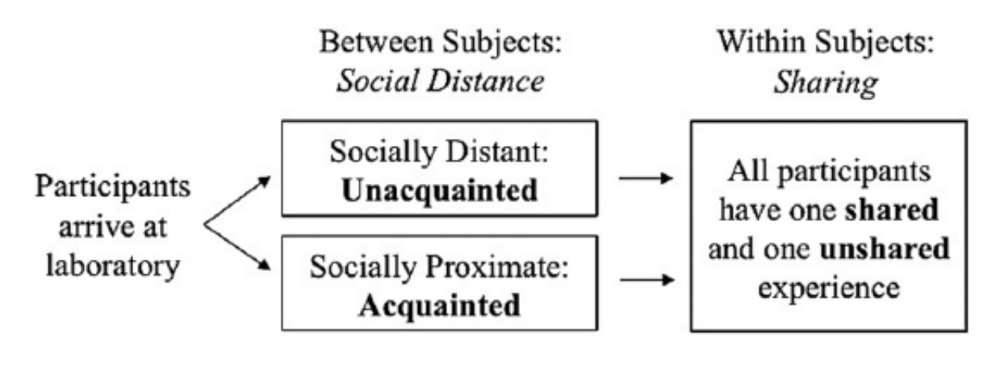{height="200px"}

:::

::: {.column width="50%"}

- **shared**: eating chocolate at the same time as partner
- **unshared**: eating chocolate while partner doing something else
- **alone**: control group who did the whole thing alone

:::

::::

$N=44$ participants were all women 19-25 from Harvard who met with a confederate; social proximity created through an 'ice-breaker' task; $N=21$ participants in the control group

task: 
- taste two chocolates (A & B) once while confederate was also tasting, once while C was viewing a piece of artwork (chocolates were identical)

- (DV1) *chocolate enjoyment*: aggregated responses to "How much do you like this chocolate?" and "How flavorful is this chocolate?"
- (DV2) *experience enjoyment*: "How do you feel right now?" + "How absorbed are you in the experience of eating this chocolate?"

## results {background-color="white"}

:::: {.columns}

::: {.column width="60%"}

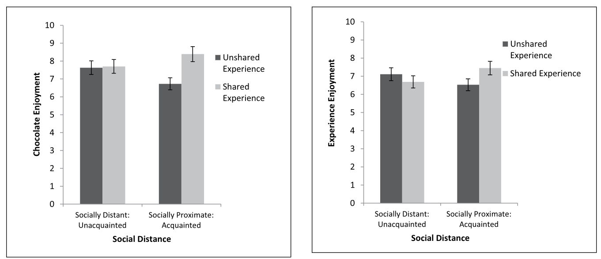{fig-align="center"}

:::

::: {.column width="33%"}

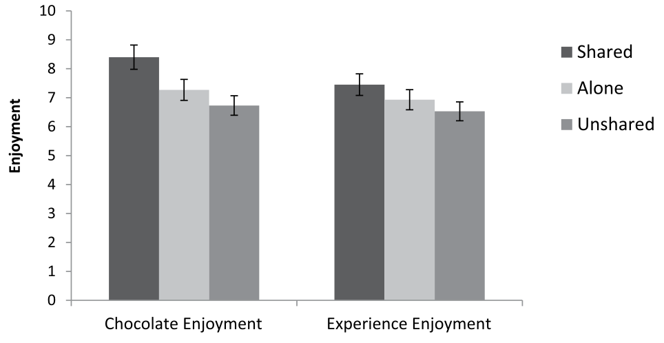{height="200px"}

:::

::::

@Boothby_et-al_2016; Social amplification depends on social proximity; participants' enjoyment of the chocolate was amplified when shared and de-amplified when unshared with a socially proximate co-experiencer, compared with being alone.

## physiological synchrony during movie watching {background-color="white"}

:::: {.columns}

::: {.column width="50%"}

:::

::: {.column width="50%"}

22 triplets of female participants watched two 7-minute movie clips, one negative and one positive, while physiological measures were recorded from 2 of them:

- electrodermal activity (EDA)
- electrocardiogram (ECG)

On each time-series, an inter-subject correlation (ISC) was calculated (max correlation of time-series within +/- 10 seconds)

:::

::::

## @Golland_Arzouan_Levit-Binnun_2015 results {background-color="white"}

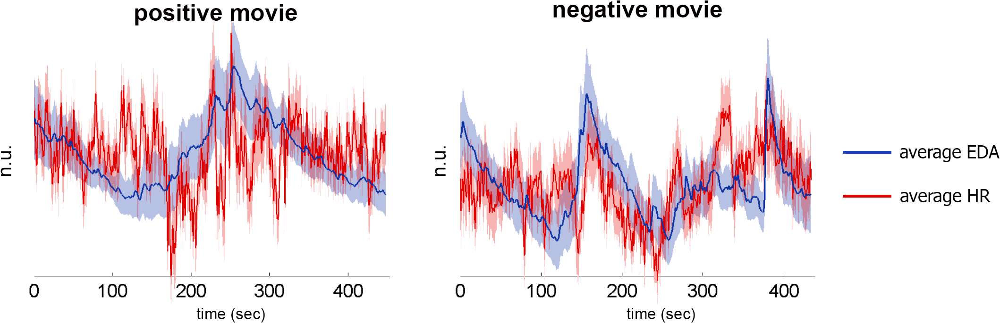

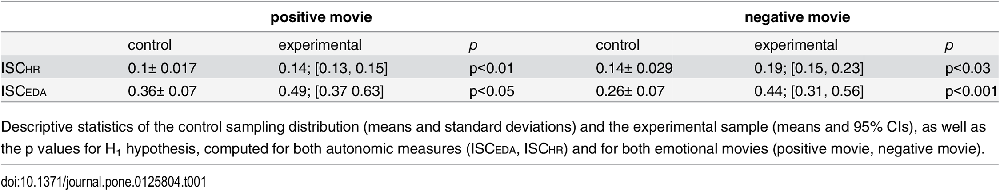

## heart rate synchrony in a haunted house {background-color="white" .smaller}

:::: {.columns}

::: {.column width="60%"}

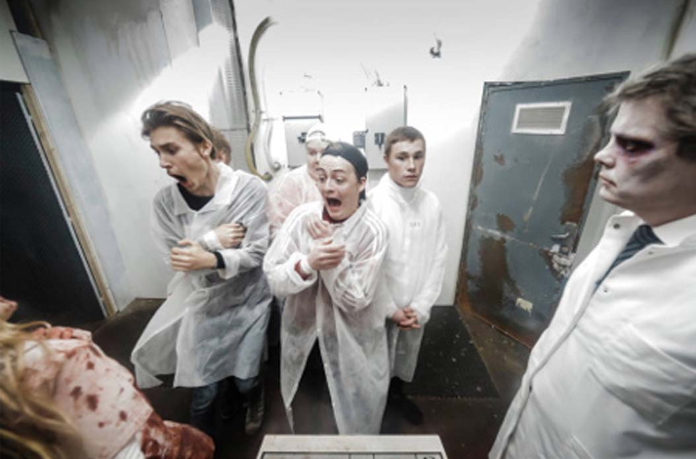

:::

::: {.column width="40%"}

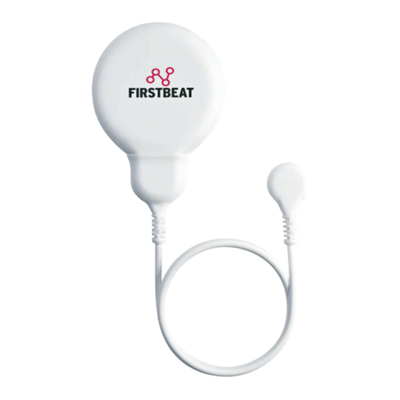

:::

::::

$N=347$ participants (18-63 years old; forming 87 groups) wore HR monitors going through a 55-minute haunted house in Copenhagen. Each participant identified the group members to whom they felt close

**Do people who experience synchrony with others in the group also experience greater emotional arousal?**

**Is synchrony higher in emotionally close dyads?**

## {background-color="white"}

:::: {.columns}

::: {.column width="35%"}

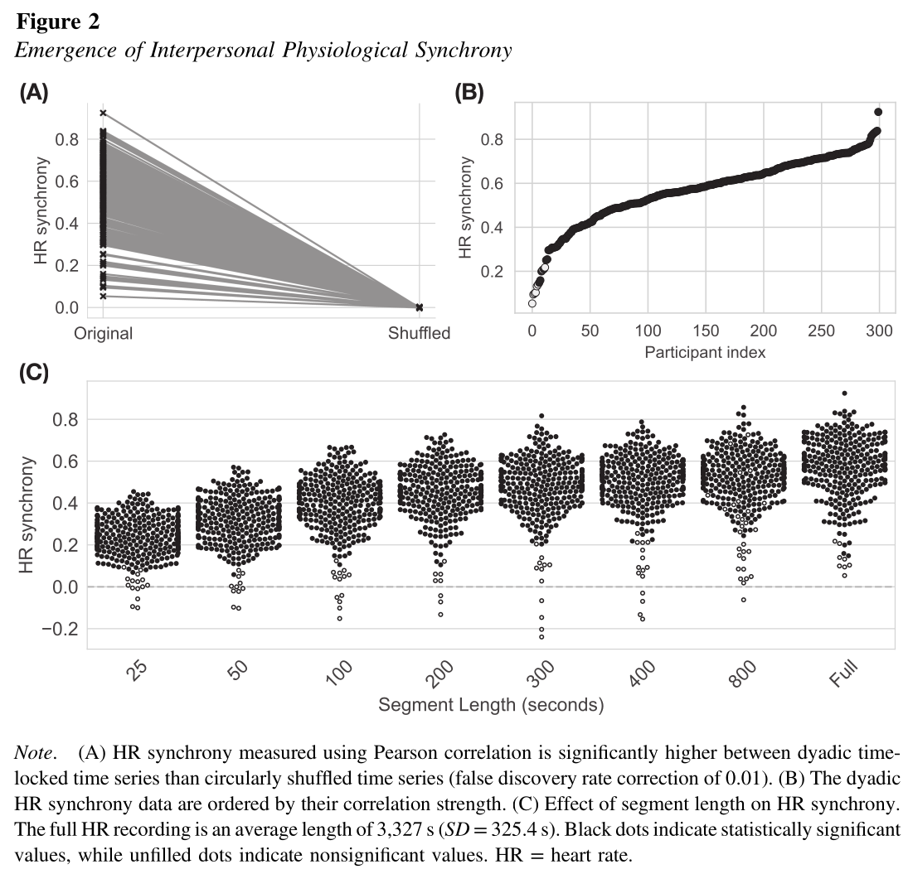

:::

::: {.column width="65%"}

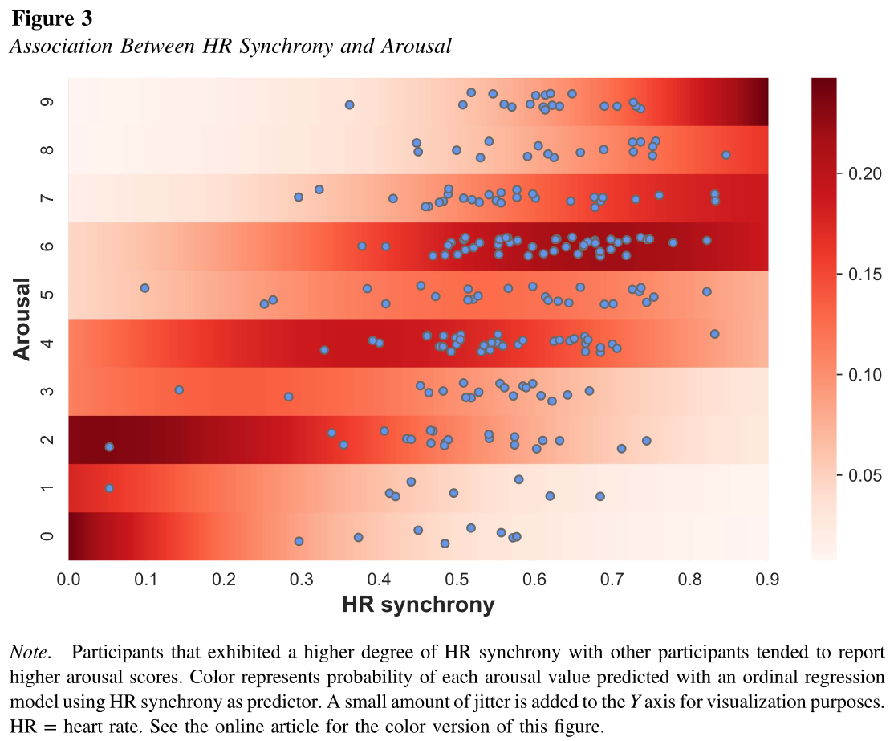{height="300px"}

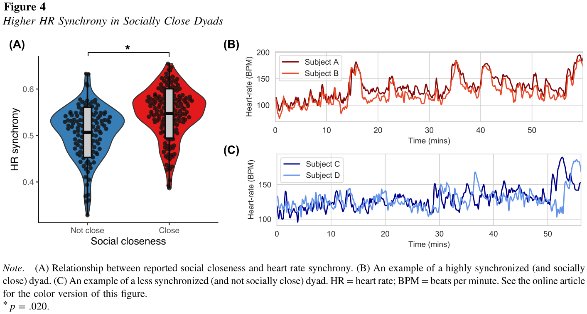{height="350px"}

:::

::::

## emotional intensity and bonding {background-color="white" .smaller}

:::: {.columns}

::: {.column width="70%"}

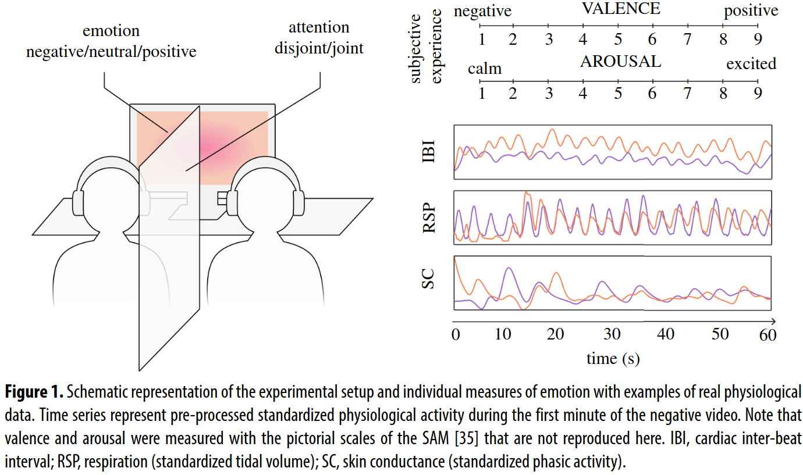{fig-align="center"}

:::

::: {.column width="30%"}

56 unacquainted dyads watched 5-min videos together under two conditions: **joint v. disjoint attention**
  
1. positive (comedy)
2. negative (animal cruelty)
3. neutral (university library)

electrophysiological measurements of emotional arousal recorded continuously and used to predict development of feelings of mutual connectedness 

:::

::::

::: {.notes}
- disjoint condition: separated by an orange curtain
:::

## {background-image="img/chung_et-al_results.png" background-size="contain" background-color="white"}

## key ideas {.smaller}

- people spontaneously represent the perspectives of others
- presence of others can improve or impair performance depending on task complexity
- one idea is that they adopt a 'collective' (we-mode) representation
- there are effects of the 'collective mind' on judgment and action
  - interference from another's inconsistent motor representations
  - considering another's lack of knowledge when interpreting words
    - but there are limits on how effectively this ability is used in language processing
  - sharing attention leads to feelings of closeness and trust
    - especially if the sharing is in "common ground"
- 'collective mind' also has emotional effects
  - mere presence of others leads to 'social buffering'
  - emotional experience is amplified among social acquaintances
  - people watching a movie synchronize their emotional responses
  - synchrony with others enhances emotional arousal and feelings of connectedness
    - higher synchrony in close dyads
	- modulated by joint attention
  

# references {.smaller}

::: {#refs}
:::
